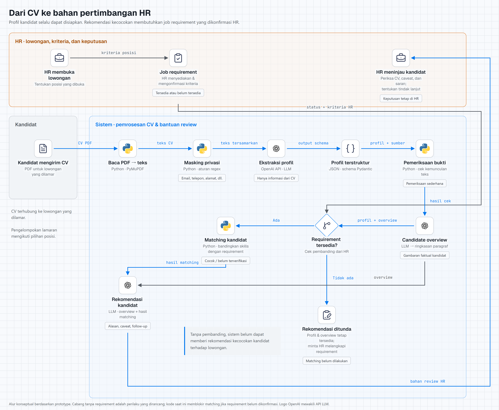

# Mini Assignment Sekolah Karir

Prototipe asisten peninjauan CV berbasis LLM untuk mini assignment Sekolah Karir. Sistem mengubah CV PDF menjadi profil terstruktur, memeriksa dukungan informasi pada teks CV, lalu membantu menjelaskan kecocokan kandidat dengan kebutuhan pekerjaan. Hasilnya menjadi bahan pertimbangan HR dan tetap memerlukan peninjauan manusia.

## Cara kerja

Sistem menggabungkan LLM dengan pemeriksaan berbasis aturan. LLM digunakan untuk mengekstrak profil, membuat ringkasan, dan menyusun penjelasan rekomendasi. Sementara itu, kode Python menangani pembacaan PDF, masking informasi pribadi, pengecekan bukti, pencocokan skill, dan aturan wajib peninjauan manusia.

## Alur pemrosesan

1. **Baca CV** — mengambil teks dari PDF yang memiliki lapisan teks.
2. **Masking data pribadi** — menyamarkan informasi seperti email, nomor telepon, dan alamat yang dikenali oleh aturan.
3. **Ekstraksi profil** — menyusun pendidikan, skill, pengalaman, proyek, dan sertifikasi ke dalam struktur data Pydantic.
4. **Validasi bukti** — memeriksa apakah skill dan beberapa field profil ditemukan pada teks CV.
5. **Ringkasan kandidat** — merangkum profil beserta informasi yang belum jelas atau perlu dikonfirmasi.
6. **Matching pekerjaan** — membandingkan skill yang didukung teks CV dengan skill wajib dan tambahan pada job requirement.
7. **Rekomendasi peninjauan** — memberikan alasan, catatan keterbatasan, dan tindak lanjut untuk HR.

## Hasil dan batasan

Output mencakup profil kandidat, evidence checks, ringkasan, hasil matching, dan rekomendasi peninjauan. Demo juga menyertakan evaluasi batch pada lima CV fiktif, metrik ekstraksi skill untuk satu CV, serta pemeriksaan privasi dan aturan rekomendasi.

Matching dan rekomendasi membutuhkan **job requirement yang sudah dikonfirmasi**. Tahap ekstraksi hingga ringkasan tidak bergantung pada requirement tersebut, tetapi notebook saat ini belum otomatis melewati tahap matching ketika requirement tidak tersedia.

Validasi bukti menggunakan pencarian teks sederhana; hasil yang belum terverifikasi perlu diperiksa kembali. Rekomendasi bukan keputusan menerima atau menolak kandidat.

## Demo dan teknologi

Lihat [demo_rapi.ipynb](demo_rapi.ipynb) untuk alur lengkap beserta penjelasan tiap tahap. Jalankan berurutan menggunakan environment proyek dan `OPENAI_API_KEY` yang valid; tahap LLM memanggil API OpenAI.

**Teknologi:** Python, OpenAI API, Pydantic, PyMuPDF, dan pandas.
